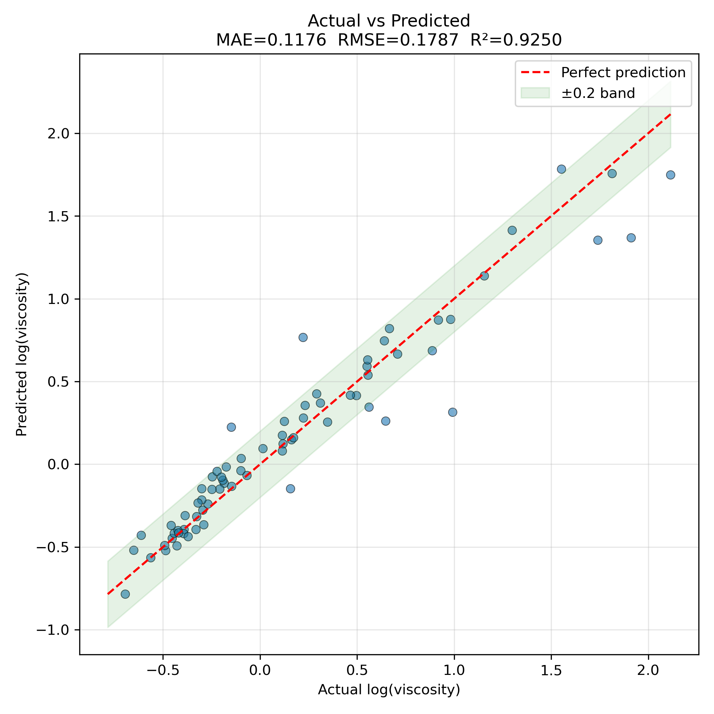
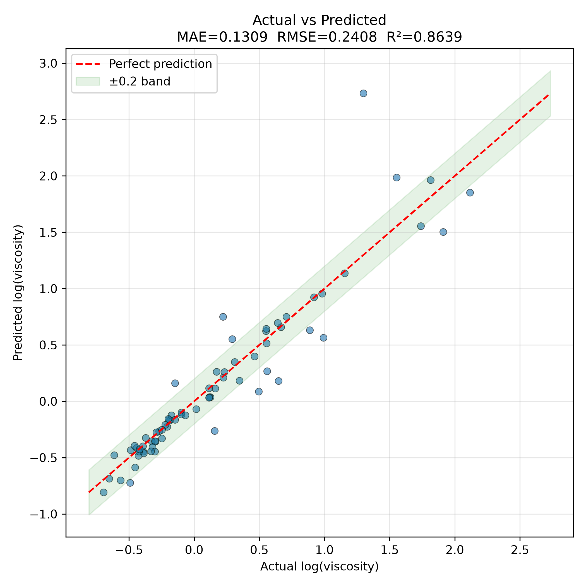
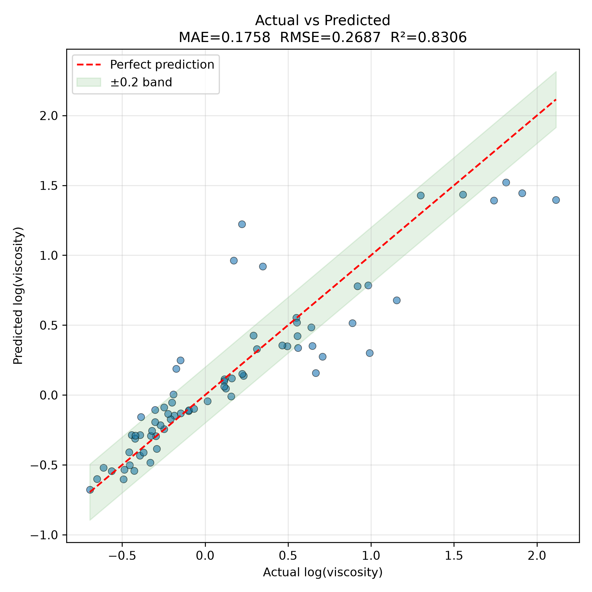

# AITW_viscosity_surrogate

Four approaches used to predict the viscosity of chemical compounds from their SMILES representations.
Together they span classical machine learning, pure deep learning on molecular language, a hybrid architecture combining both, and a final ensemble that unifies all three.

## Dataset

- Viscosities taken from [Katritzky et al. (2000)](https://onlinelibrary.wiley.com/doi/10.1002/(SICI)1099-1395(200001)13:1%3C80::AID-POC179%3E3.0.CO;2-8)
- SMILES strings taken from [PubChem](https://pubchem.ncbi.nlm.nih.gov/) using the API https://pubchem.ncbi.nlm.nih.gov/rest/pug/compound/name/{}/property/CanonicalSMILES/TXT

## Installation

```bash
cd <PATH to folder with pyproject.toml>
pip install .
```

## Usage

### CLI

The installation will make available a `aitw-viscosity-surrogate` command line interface.

- Run `aitw-viscosity-surrogate --help` to see the available commands.

More information on the CLI can be found in the approach-specific subsections

#### Tab autocompletion

Enabling tab autocompletion https://click.palletsprojects.com/en/stable/shell-completion/

E.G for `bash` run the command

```bash
eval "$(_AITW_INFILTRATION_SURROGATE_COMPLETE=bash_source aitw-viscosity-surrogate)"
```

You can also add it to either `~/.bashrc` or, if you are using a virtual environment, to `bin/activate` of the virtual environment to avoid running the command for every new shell.

## Approaches

### Dataset format

For all approaches, the input dataset must be a CSV file containing the following columns:

- `compound_name`: The name of the compound.
- `SMILES`: The SMILES representation of the compound.
- `log_visc_calc`: The calculated log-viscosity of the compound.
- `log_visc_exp`: The experimentally measured log-viscosity of the compound.
- `visc_mPas_calc`: The calculated viscosity of the compound in mPa·s.
- `visc_mPas_exp`: The experimentally measured viscosity of the compound in mPa·


### 1. Baseline: XGBoost with Molecular Fingerprints and Descriptors

The first approach represents a classical cheminformatics pipeline in which each molecule is converted into a fixed-length numerical vector composed of a 2048-bit Morgan fingerprint and the full set of RDKit-computed physicochemical descriptors, including molecular weight, polarity, hydrogen-bonding capacity, and topological complexity.
These features are fed into an XGBoost gradient-boosted tree regressor, which learns nonlinear relationships between molecular structure and log-viscosity without requiring any deep learning.
This approach serves as a strong, interpretable baseline against which more complex models can be compared.

#### Training

```bash
aitw-viscosity-surrogate xgboost train --help
aitw-viscosity-surrogate xgboost train \
  --input-file examples/dataset.csv
```

The output of the training command contains the following files:

- `{output_dir}/xgboost_model.json`: The trained XGBoost model in JSON format.
- `{output_dir}/viscosity_performance.png`: A plot of predicted vs. experimental log-viscosity values for the training set.
- `{output_dir}/viscosity_predictions.csv`: A CSV file containing the predicted log-viscosity values and errors for the training set.
- `{output_dir}/training.log`: A log file containing the training process.

#### Inference

Inference can be ran using a pre-trained model included in the package or a custom model trained using the `train` command.
The input file must be a CSV file containing the following columns:
- `compound_name`: The name of the compound.
- `SMILES`: The SMILES representation of the compound.
- `visc_mPas_exp`: OPTIONAL. The reference viscosity of the compound in mPa·s. If provided, the error between predicted and reference values will be calculated and included in the output.

```bash
aitw-viscosity-surrogate xgboost inference --help
aitw-viscosity-surrogate xgboost inference \
  --input-file examples/dataset.csv \
  --output-file xgboost_predictions.csv
```

It will produce a CSV file containing the predicted log-viscosity values for the input compounds.

The `xgboost_model.json` file included in the package was trained on the dataset provided in `examples/dataset.csv`.
<!-- It's validation is shown [in this plot](./images/xgboost_train.png). -->



### 2. Pure LLM: Fine-Tuned ChemBERTa

The second approach treats each molecule's SMILES string as a sentence in a chemical ``language'' and fine-tunes ChemBERTa, a transformer model pretrained on millions of molecules, to predict viscosity directly from this textual representation. No hand-crafted descriptors are used; instead, the model relies entirely on the contextual embeddings it has learned during pretraining, with a small feed-forward regression head mapping the resulting molecular embedding to a single viscosity value. This approach tests whether a language model can capture the structure-property relationships needed for viscosity prediction without any explicit chemical feature engineering.

#### Training

```bash
aitw-viscosity-surrogate chemberta train --help
aitw-viscosity-surrogate chemberta train \
  --input-file examples/dataset.csv
```

The output of the training command contains the following files:

- `{output_dir}/chemberta_model_base.pt`: The trained ChemBERTa model in PyTorch format. This will be a dictionary containing the `model_state_dict` and the ChemBERTa model name used for training (`model_name`).
- `{output_dir}/viscosity_performance.png`: A plot of predicted vs. experimental log-viscosity values for the training set.
- `{output_dir}/viscosity_predictions.csv`: A CSV file containing the predicted log-viscosity values and errors for the training set.
- `{output_dir}/training.log`: A log file containing the training process.
- `{output_dir}/train_test_indexes.json`: A JSON file containing the indexes of the training and test sets used for training and validation.

#### Inference

Inference can be ran using a pre-trained model included in the package or a custom model trained using the `train` command.
The input file must be a CSV file containing the following columns:
- `compound_name`: The name of the compound.
- `SMILES`: The SMILES representation of the compound.
- `visc_mPas_exp`: OPTIONAL. The reference viscosity of the compound in mPa·s. If provided, the error between predicted and reference values will be calculated and included in the output.

```bash
aitw-viscosity-surrogate chemberta inference --help
aitw-viscosity-surrogate chemberta inference \
  --input-file examples/dataset.csv \
  --output-file chemberta_predictions.csv
```

It will produce a CSV file containing the predicted log-viscosity values for the input compounds.

The `chemberta_model_base.pt` file included in the package was trained on the dataset provided in `examples/dataset.csv`.




### 3. Hybrid: ChemBERTa with Residual Descriptor Fusion

The third approach combines the strengths of the previous two methods by fusing ChemBERTa's learned molecular embedding with ten classical RDKit descriptors, projecting the combined representation through a residual neural network with skip connections to preserve information across layers. This architecture allows the model to leverage both the rich, pretrained chemical knowledge encoded in ChemBERTa and the well-established physical intuition captured by classical descriptors, resulting in improved predictive accuracy over either approach used alone.

#### Training

```bash
aitw-viscosity-surrogate chemberta-residuals train --help
aitw-viscosity-surrogate chemberta-residuals train \
  --input-file examples/dataset.csv
```

The output of the training command contains the following files:

- `{output_dir}/chemberta_model_residuals.pt`: The trained ChemBERTa model in PyTorch format. This will be a dictionary containing the `model_state_dict`, the ChemBERTa model name used for training (`model_name`) and the scaler (`scaler`).
- `{output_dir}/viscosity_performance.png`: A plot of predicted vs. experimental log-viscosity values for the training set.
- `{output_dir}/viscosity_predictions.csv`: A CSV file containing the predicted log-viscosity values and errors for the training set.
- `{output_dir}/training.log`: A log file containing the training process.
- `{output_dir}/train_test_indexes.json`: A JSON file containing the indexes of the training and test sets used for training and validation.

#### Inference

Inference can be ran using a pre-trained model included in the package or a custom model trained using the `train` command.
The input file must be a CSV file containing the following columns:
- `compound_name`: The name of the compound.
- `SMILES`: The SMILES representation of the compound.
- `visc_mPas_exp`: OPTIONAL. The reference viscosity of the compound in mPa·s. If provided, the error between predicted and reference values will be calculated and included in the output.

```bash
aitw-viscosity-surrogate chemberta-residuals inference --help
aitw-viscosity-surrogate chemberta-residuals inference \
  --input-file examples/dataset.csv \
  --output-file chemberta_residuals_predictions.csv
```

It will produce a CSV file containing the predicted log-viscosity values for the input compounds.

The `chemberta_model_residuals.pt` file included in the package was trained on the dataset provided in `examples/dataset.csv`.




### 4. Ensemble: Combining XGBoost and Two ChemBERTa Variants

The final approach trains three separate models, an XGBoost regressor, a simple fine-tuned ChemBERTa model, and the residual ChemBERTa-descriptor hybrid, and then searches over weighted combinations of their predictions to find the optimal blend. By systematically testing different weightings across all three models on a held-out test set, this ensemble approach demonstrates that combining diverse modeling strategies, each capturing different aspects of molecular structure, yields more robust and accurate viscosity predictions than any single model in isolation.

#### Training

#### Inference


